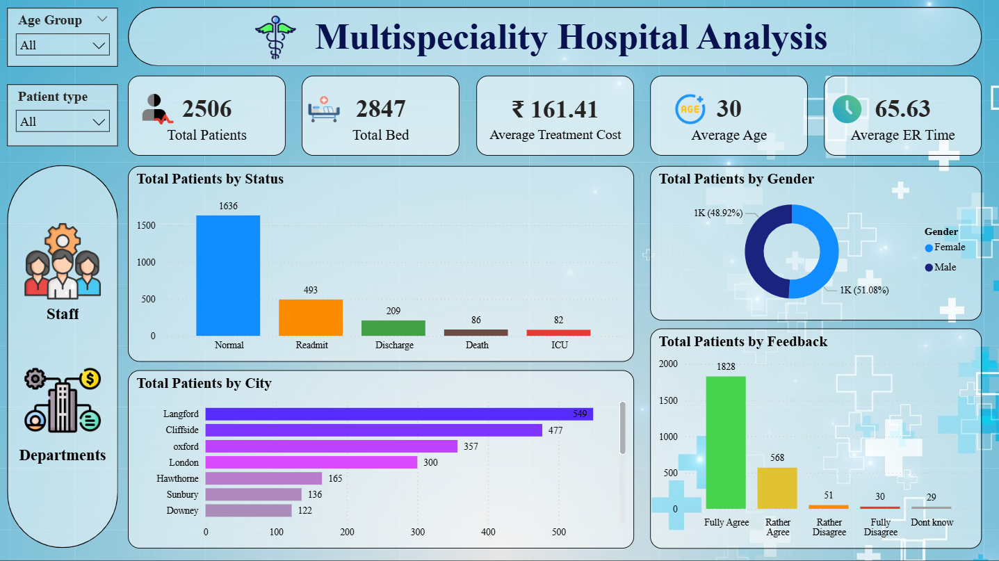
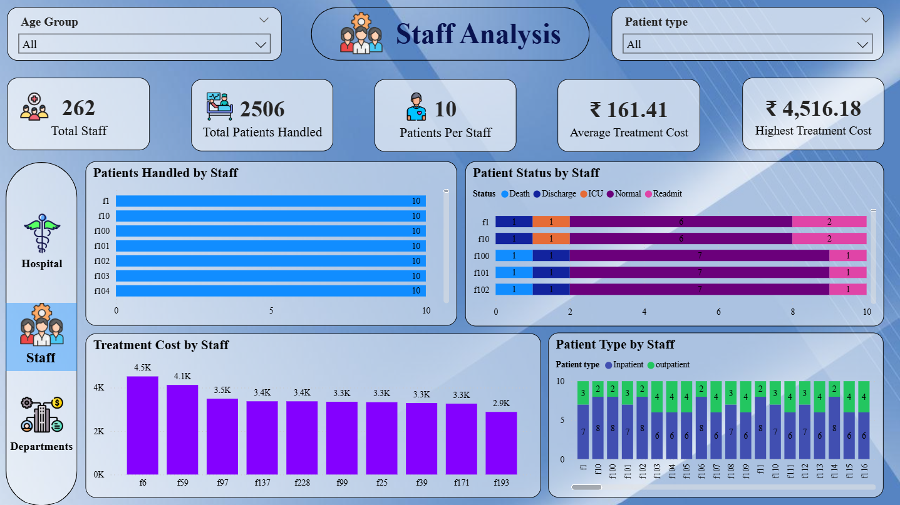
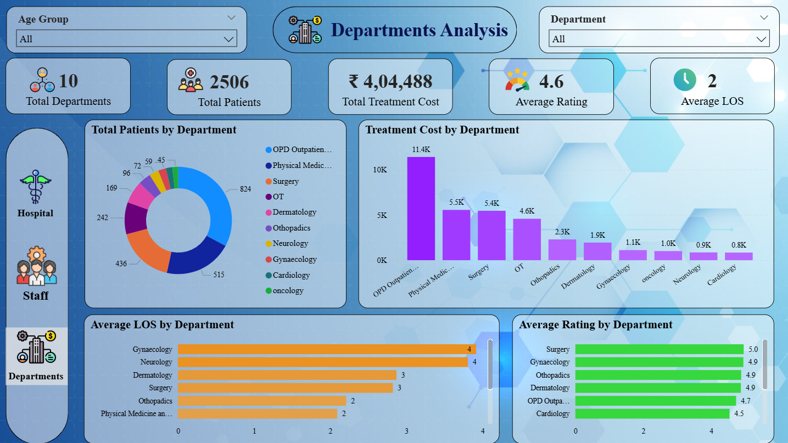

# 🏥 Multi-Specialty Hospital Analytics Dashboard

**An interactive Power BI dashboard for analyzing patients, staff, and departments in a multi-specialty hospital**

This project turns raw hospital records into a three-page Power BI report. It helps hospital management track patient volume, treatment cost, length of stay, staff workload, and patient feedback in one place.


## Table of Contents

- [Features](#features)
- [Dashboard Pages](#dashboard-pages)
- [Dataset](#dataset)
- [Key Insights](#key-insights)
- [Tech Stack](#tech-stack)
- [Project Structure](#project-structure)
- [Getting Started](#getting-started)
- [Screenshots](#screenshots)
- [Author](#author)
- [License](#license)

## Features

- **Hospital overview:** Total patients, beds, average treatment cost, average age, and average ER time at a glance
- **Patient analysis:** Breakdown by status, gender, city, and feedback
- **Department analysis:** Patient volume, treatment cost, average length of stay (LOS), and rating for each department
- **Staff analysis:** Patients handled per staff member, patient status, treatment cost, and inpatient vs. outpatient split
- **Interactive filters:** Slicers for age group, patient type, and department
- **Easy navigation:** Sidebar buttons to move between pages

## Dashboard Pages

| Page | What it shows |
|------|---------------|
| **Hospital** | Overall KPIs, patients by status, gender, city, and feedback |
| **Staff** | Staff workload, patient outcomes, treatment cost, and patient type by staff member |
| **Departments** | Patients, cost, length of stay, and ratings across 10 departments |

## Dataset

The data is an Excel workbook (`Data/Hospital Health Care Management Data set.xlsx`) with four sheets:

| Sheet | Records | Description |
|-------|---------|-------------|
| Detail data | 2,506 | Patient records: demographics, patient type, status, treatment cost, length of stay, ER time, feedback, and rating |
| Staff_Detail | 262 | Staff IDs and names |
| Department | 10 | Department IDs and names |
| Bed_Detail | 2,847 | Bed IDs and bed numbers |

## Key Insights

- The hospital recorded **2,506 patients** across **2,847 beds**, with an average treatment cost of **₹161.41**.
- **1,636 patients** had a normal status, while **493** were readmitted.
- **OPD Outpatient** had the most patients (824) and the highest treatment cost.
- **Gynaecology** and **Neurology** had the longest average stay, at about 4 days.
- **Surgery** had the highest average patient rating (5.0), and the overall average rating is **4.6**.
- **1,828 patients** fully agreed with the feedback statement, the most common response.
- Each staff member handles about **10 patients** on average.

## Tech Stack

| Category | Tools |
|----------|-------|
| Visualization | Power BI Desktop |
| Data preparation | Power Query |
| Calculations | DAX |
| Data source | Microsoft Excel |

## Project Structure

```text
Multi-Specialty-Hospital-Analytics-Dashboard/
├── Data/
│   └── Hospital Health Care Management Data set.xlsx
├── Icons/                       # Icons and backgrounds used in the report
├── PowerBI/
│   └── Hospital Analysis.pbix   # Power BI report file
├── Screenshots/
│   ├── Hospital_Analysis.png
│   ├── Staff_Analysis.png
│   └── Departments_Analysis.png
└── README.md
```

## Getting Started

### Prerequisites

| Requirement | Notes |
|-------------|-------|
| Power BI Desktop | Free download from Microsoft (Windows only) |
| Microsoft Excel | Optional, only needed to view the raw data |
| Git | Optional, only needed to clone the repository |

### Steps

1. **Clone the repository**

```bash
   git clone https://github.com/Prayasit/Multi-Specialty-Hospital-Analytics-Dashboard.git
```

2. **Open the report**

   Open `PowerBI/Hospital Analysis.pbix` in Power BI Desktop.

3. **Fix the data source path**

   If Power BI cannot find the data, go to **Home → Transform data → Data source settings**, choose **Change Source**, and point it to `Data/Hospital Health Care Management Data set.xlsx`. Then select **Refresh**.

4. **Explore the dashboard**

   Use the slicers and the sidebar buttons to move between the Hospital, Staff, and Departments pages.

## Screenshots

| Hospital Overview |
|-------------------|
|  |

| Staff Analysis |
|----------------|
|  |

| Departments Analysis |
|----------------------|
|  |

## Author

**Prayas Gotefode**

MCA Student | Data Analytics and Software Development

- GitHub: [Prayasit](https://github.com/Prayasit)
- LinkedIn: [Prayas Gotefode](https://www.linkedin.com/in/prayas-gotefode-819718401)

## License

Developed as a portfolio project. The dataset is used for educational purposes.

---

⭐ If you find this project useful, consider giving the repository a star!
